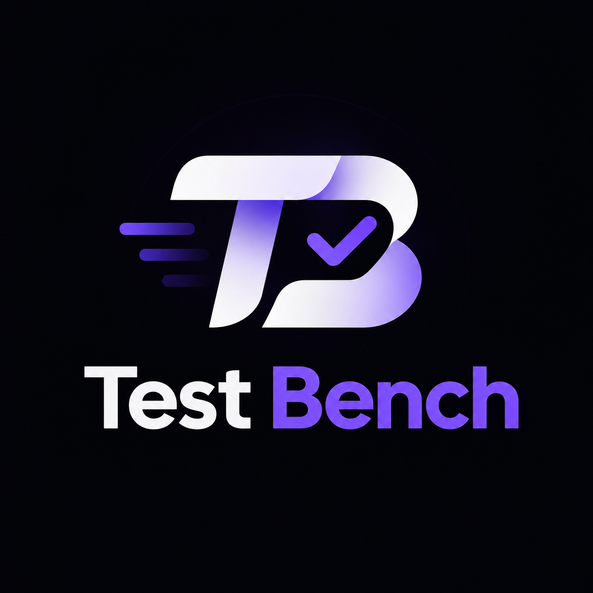

<div align="center">



# 🎯 TestBench `v0.1.02`

### **Offline-First NTA CBT Mock Test Simulator, Q&A Database & PDF Extraction Platform**

[](#-release-v0102)
[](https://react.dev/)
[](https://www.typescriptlang.org/)
[](https://tailwindcss.com/)
[](backend/)
[](render.yaml)
[](#-license)

---

*Built for **JEE Main**, **NEET UG**, and **WB Primary TET** aspirants with authentic Computer-Based Test (CBT) fidelity, light & dark modes, bilingual EN/BN support, mobile-optimized touch controls, searchable Q&A database, and an extensible Python PDF extraction framework.*

</div>

---

## 🏷️ Release `v0.1.02`

- **Current Version:** `v0.1.02` (displayed in the TestBench header, footer, and Settings **About** card)
- **What's new in `v0.1.02`:**
  - **WB Primary TET Integration**: Added WBTET category with official 2022 and 2023 question papers (150 Qs each, 150 marks, 150 min).
  - **Bilingual EN/BN Support**: Language selector for Bengali and English with per-question text fallback and translated UI strings.
  - **Mobile-First UX Overhaul**: 44px+ touch targets, sticky bottom action bar, responsive summary headers, and slide-out question palette bottom sheet (`PaletteSheet`).
  - **Timer & Attempt Resiliency**: Absolute timestamp `endsAt` drift-proof countdown, automatic background autosave in IndexedDB (`Dexie`), and in-progress attempt resumption.
  - **Granular Scorecards & Analytics**: Custom section attempt limit handling, rushed guess detection (`<10s`), weak-topic insights, and 1-click **Retry Wrong & Skipped** practice tests.
- **Core platform highlights:**
  - Full catalog of **9 Official Papers** across **JEE Main**, **NEET UG**, and **WB Primary TET** with 1,300+ cropped diagrams and options.
  - Official NTA **5-State Question Palette** (`Not Visited`, `Not Answered`, `Answered`, `Marked for Review`, `Answered & Marked`).
  - Strict marking engine supporting single-choice, multiple-choice (partial scoring), numeric keypad, and true/false questions.
  - 100% offline-first execution: runs entirely within your browser with zero network lag or tracking.

---

## ✨ Key Features

<table>
<tr>
<td width="50%" valign="top">

### 🖥️ Authentic NTA CBT Player
- **5-State Palette**: Color-coded status badges matching NTA rules (`answeredMarked` counts toward evaluation)
- **Drift-Proof Timer**: Absolute `endsAt` countdown with 5-min warning & 1-min urgent alert + auto-submit
- **Sectional Controls**: Custom marking (`+4/-1`, `+4/0`), attempt limits (`any 5 of 10`, `any 10 of 15`), and pre-submit summary
- **Multi-Format Questions**: Single-choice (including multi-key/bonus official keys), Multi-select (partial marking), Numerical keypad (`0–9`, `.`, `-`), and True/False
- **KaTeX Math**: Crisp inline `$...$` and display `$$...$$` rendering

</td>
<td width="50%" valign="top">

### 📊 Insights, Q&A DB & Themes
- **Accurate Scorecard**: Section-wise breakdown, negative marking loss, rushed guesses (`<10s`), weak topics, and instant **Retry Wrong & Skipped** generator
- **Solution Review**: Filter by `All`, `Correct`, `Wrong`, or `Skipped` with per-question time spent & answer comparison
- **Q&A Database Screen**: Browse cropped question & option cards across all extracted papers
- **Light & Dark Mode**: Persisted across Library, Instructions, Exam, Scorecard, Review, Analytics, and Settings
- **Offline Persistence**: Runs smoothly offline in your browser with IndexedDB (Dexie) crash recovery & autosave

</td>
</tr>
</table>

---

## 📚 Built-in Official Papers Catalog

| Exam | Year | Paper / Session | Questions | Duration | Max Marks |
| :--- | :---: | :--- | :---: | :---: | :---: |
| 🟦 **JEE Main** | `2026` | April Session (02 Apr, Shift 2) | 75 Qs | 180 min | 300 |
| 🟦 **JEE Main** | `2024` | January Session 1 (27 Jan, Shift 1) | 90 Qs *(75 counted)* | 180 min | 300 |
| 🟦 **JEE Main** | `2023` | April Session 2 (06 Apr, Shift 1) | 90 Qs *(75 counted)* | 180 min | 300 |
| 🟩 **NEET UG** | `2026` | Official Question Paper | 180 Qs | 180 min | 720 |
| 🟩 **NEET UG** | `2025` | Official Question Paper (Booklet 45) | 180 Qs | 180 min | 720 |
| 🟩 **NEET UG** | `2024` | Official Question Paper (Booklet S6) | 200 Qs *(180 counted)* | 200 min | 720 |
| 🟩 **NEET UG** | `2023` | Official Question Paper (Booklet G6) | 200 Qs *(180 counted)* | 200 min | 720 |

---

## 🏗️ Architecture & Project Layout

```text
Work/
├── testbench/                  # React 19 + TypeScript + Vite 8 + Tailwind v4 Frontend
│   ├── src/
│   │   ├── core/               # Schema (Zod v4), Marking Engine, CBT State Machine, v0.0.2(beta)
│   │   ├── features/           # Library, Paper Detail, Exam, Result, Review, Analytics, Q&A DB, Settings
│   │   └── data/               # Dexie IndexedDB repositories & static catalog loader
│   └── public/                 # Built-in JEE & NEET papers, Q&A JSONs, and cropped PNG assets
├── backend/                    # Interdependent FastAPI + SQLite FTS5 REST API
│   ├── app/                    # Health, Papers, Q&A endpoints, Admin ingest & asset streaming
│   └── tests/                  # Pytest API & ingest suite
├── tools/pdf_qna_pipeline/     # Config-driven PDF -> QnA JSON & TestBench paper extractor
│   ├── configs/                # Exam YAML definitions (jee_main, neet_2023..2026)
│   ├── parsers/                # NTA CBT, ExamGOAL cleaned, and scanned NEET parsers
│   └── extractors/             # High-DPI clipping, whitespace trim & watermark cleanup
└── render.yaml                 # Render Blueprint (Static Site + Free Python Web Service)
```

---

## 🛠 PDF-to-QnA Extraction Pipeline (`tools/pdf_qna_pipeline`)

Config-driven Python pipeline (`PyMuPDF`, `Pillow`, `OpenCV`, `Pydantic v2`, `PyYAML`) for converting exam PDFs into clean datasets:

```bash
# Inspect PDF structure and record layout profile
python -m tools.pdf_qna_pipeline.cli inspect -i "path/to/exam.pdf" -o "dist/qna/output"

# Extract questions, clip diagrams, export QnA + TestBench JSON, and validate
python -m tools.pdf_qna_pipeline.cli extract -i "path/to/exam.pdf" -o "dist/qna/output" -c "tools/pdf_qna_pipeline/configs/jee_main.yaml"

# Run standalone 8-point integrity validator
python -m tools.pdf_qna_pipeline.cli validate -i "dist/qna/output/qna_database.json" -c "tools/pdf_qna_pipeline/configs/jee_main.yaml"
```

---

## 🚀 Getting Started Locally

### Frontend (`testbench/`)
```bash
cd testbench
npm install
npm run dev      # Start Vite dev server
npm run lint     # Run oxlint
npm run build    # TypeScript check + Vite production bundle
npx vitest run   # Run frontend unit & catalog validation tests
```

### Backend API & Pipeline (`backend/`, `tools/pdf_qna_pipeline/`)
```bash
pip install -r backend/requirements.txt
uvicorn backend.app.main:app --reload --port 8000
python -m pytest backend/tests tools/pdf_qna_pipeline/tests -q
```

### ☁️ One-Click Cloud Deployment (Render)
Deploy both **`testbench-web`** (Static Site) and **`testbench-api`** (Free Python Web Service) directly from GitHub via [render.yaml](render.yaml).

---

## 🔒 Security & Privacy

- **Local-First Execution**: All student answers, timers, and scores stay in your browser's IndexedDB (`Dexie`) — no tracking or third-party cookies.
- **XSS Sanitization**: Math & rich text rendering is sanitized through `DOMPurify`.
- **Fail-Closed Backend Config**: Production mode (`ALLOW_INSECURE_DEV=0`) requires a real `ADMIN_TOKEN` and rejects wildcard `*` `CORS_ORIGINS`.

---

## 📄 License

Distributed under the **MIT License**.
