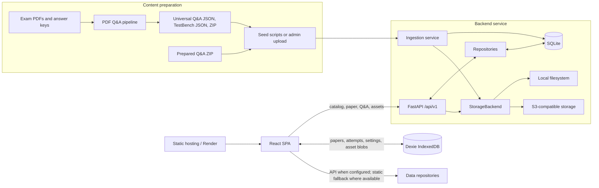

# TestBench Architecture

This document describes the implementation present in this repository. TestBench is a monorepo containing a React/TypeScript mock-exam application (`testbench/`), a FastAPI service backed by SQLite and pluggable asset storage (`backend/`), a PDF-to-question extraction toolkit (`tools/pdf_qna_pipeline/`), seed and migration utilities, and deployment configuration (`render.yaml`). The API and browser client are implemented; Android is a possible future API client, not a checked-in application.

## 1. System at a glance

The backend is the authoritative source for published paper records and their associated Q&A, answer data, and image assets in the API deployment. The frontend stores downloaded data in IndexedDB to support offline use and can use the repository's static-data fallback mode where configured. Exam answering, timing, response persistence, and score calculation run in the browser. Admin routes and seed scripts are the backend write paths for content and metadata.

## 2. Repository responsibilities

| Path | Responsibility |
| --- | --- |
| `backend/app/main.py` | FastAPI factory, lifespan and migration startup, route registration, CORS, error envelopes, health check, and production admin-token guard. |
| `backend/app/settings.py` | Environment and `.env` configuration for database, storage, CORS, upload limits, and admin access. |
| `backend/app/db.py`, `backend/app/migrations/` | SQLite connection setup, migration runner, schema, and per-operation database connections. |
| `backend/app/routes/` | Versioned meta, exam, paper, Q&A, asset, and admin HTTP interfaces. |
| `backend/app/repositories/` | SQL reads and transformations for paper, question/Q&A, and ingestion data. |
| `backend/app/services/` | Ingestion, asset creation/resolution, CBT export, and asynchronous PDF-upload job orchestration. |
| `backend/app/storage/` | Storage protocol and local/S3-compatible implementations. |
| `backend/app/question_types/` | Backend question-type definitions and validation support. |
| `backend/seeds/` | Checked-in paper and Q&A inputs for initialization. |
| `testbench/src/features/` | Library, paper detail, instructions, exam, result, review, analytics, settings, and Q&A screens. |
| `testbench/src/core/` | Runtime schemas, import validation, exam state/timing, question types, marking and scoring. |
| `testbench/src/data/` | API client, Dexie schema, catalog, and data repositories. |
| `testbench/src/stores/` | Zustand-backed paper, exam, and theme state. |
| `tools/pdf_qna_pipeline/` | Config-driven PDF inspection, parsing, image extraction, answer-key application, export, and validation. |
| `contracts/scoring/` | JSON golden vectors shared by scoring verification. |
| `scripts/` | Seed orchestration, baseline generation, migration verification, and CBT paper import utilities. |
| `backend/openapi.v1.json` | Published API contract snapshot used by contract tests. |
| `render.yaml` | Static frontend and Python API Render Blueprint. |

## 3. Content and ingestion lifecycle

### 3.1 Extraction from source documents

The Python pipeline is invoked through `tools/pdf_qna_pipeline/cli.py`. Its commands include PDF inspection/profile generation, extraction, applying official keys, validation, and format export/enrichment functionality. YAML files in `configs/` define parser and exam-specific behavior. The CLI selects among NTA CBT, scanned NEET, ExamGoal NEET, and WBTET parser implementations. Parsers produce the shared Pydantic question/paper models; the image clipper extracts question and option regions into image files. Exporters produce the Universal Q&A database and TestBench paper formats, with the pipeline validating generated data before considering extraction complete.

Answer-key parsing is separate from layout extraction. `answer_keys.py` supports exam/year-specific key inputs and applies parsed answers to exported datasets. Random seeded answers are an explicit extraction option for placeholder data; they are not official keys. Configurations, answer-key data, parsers, extractors, exporters, and pipeline tests live under `tools/pdf_qna_pipeline/`.

### 3.2 Loading content into the API

There are two main content paths:

1. `scripts/seed_all_papers.py` loads repository seed data for deployment or local initialization.
2. Admin endpoints accept a prepared ZIP containing `qna_database.json` and image files, or a PDF upload plus parser configuration. PDF uploads create a job record and run in a FastAPI background task; clients can query job status. The PDF job uses the extraction/export path before ingestion.

The ingestion service validates and normalizes data, writes paper, section, question, answer, source, and asset metadata to SQLite, and stores image/package bytes through the configured storage backend. Content hashes and data versions allow clients to detect updates. Re-ingest and admin mutations update the corresponding version/hash state. Deleting a paper cascades relational rows and removes its local paper asset directory.

### 3.3 Database model

SQLite is the backend's relational catalog and question store. Migrations are numbered SQL files and recorded in `schema_migrations`; startup applies pending files. Connections enable foreign keys, WAL journaling, `synchronous=NORMAL`, and a five-second busy timeout.

The schema includes:

- `exams`: active exam registry, display order, default marking strategy, parser configuration, and JSON exam configuration.
- `papers`: identity and display metadata, exam association, schema/client requirements, publication status, content hash, and monotonically updated data version.
- `sections`: ordered paper sections, subject and question-type metadata, marking configuration, optional strategy, and attempt limit.
- `questions`: ordered question identity, section/subject/type, content blocks, options, answer and explanation JSON, and source metadata. Supported persisted types include single choice, multiple choice, numeric, and true/false.
- `assets`: per-paper filename, SHA-256, storage key, byte and dimension metadata, role, and optional question association.
- `asset_variants`: generated alternate image formats/sizes keyed to the original asset.
- `paper_packages`: prebuilt offline package variants and their version/hash/size metadata.
- `questions_fts`: SQLite FTS5 index for question-bank search.
- `jobs`: state and result/error metadata for background PDF uploads.

Repository modules encapsulate SQL retrieval and translate stored JSON columns into API paper/Q&A representations. SQLite is the metadata and structured-content store; the storage interface owns binary assets and packages.

## 4. Backend service and HTTP contract

`backend/app/main.py` creates the FastAPI application, registers routers beneath `/api/v1`, configures CORS, and normalizes request, HTTP, database, and unexpected errors into an `{ "error": { "code", "message", "details" } }` envelope. The standalone app refuses to start with an empty/example admin token unless insecure development mode is explicitly enabled. Health reports API version and database availability.

### 4.1 Public routes

| Route | Purpose |
| --- | --- |
| `GET /api/v1/health` | Liveness/readiness check including a SQLite query. |
| `GET /api/v1/meta` | API and client compatibility metadata. |
| `GET /api/v1/exams` | Active exam registry and published-paper counts. |
| `GET /api/v1/exams/{code}` | Exam configuration and its published paper summaries. |
| `GET /api/v1/papers` | Published-paper catalog with exam, year, and text filters; accepts client feature/schema headers for compatibility filtering. |
| `GET /api/v1/papers/{paper_id}` | Full paper in TestBench CBT format. |
| `GET /api/v1/papers/{paper_id}/bundle` | Paper and asset manifest in one response. |
| `GET /api/v1/papers/{paper_id}/manifest` | Asset metadata, URLs, hashes, and paper data version. |
| `GET /api/v1/papers/{paper_id}/download` | Downloadable JSON representation of a paper. |
| `GET /api/v1/papers/{paper_id}/package` | Prebuilt ZIP package; supports ETag and byte-range responses for resuming downloads. |
| `GET /api/v1/assets/{paper_id}/{filename}` | Validated asset resolution, optional width variant/WebP negotiation, ETag, and immutable cache headers. |
| `GET /api/v1/qna/{qna_id}` | Full Universal Q&A data. |
| `GET /api/v1/qna/{qna_id}/questions` | Paginated Q&A search with subject, type, section, and text/ID filters. |
| `GET /api/v1/qna/{qna_id}/questions/{q_num}` | Single question lookup by displayed number. |

Responses for paper/Q&A/manifest data use ETags and `X-Data-Version` where applicable. A matching `If-None-Match` returns `304`. The catalog endpoint understands `X-Client`, `X-Features`, and `X-Schema-Max`; the current web client sends its identity and supported question features. CORS explicitly permits the relevant request headers and exposes cache/version and range response headers.

### 4.2 Admin routes

All `/api/v1/admin/*` routes depend on `require_admin`, which checks `X-Admin-Token` using constant-time comparison. Implemented operations include PDF upload and job polling, Q&A ZIP ingestion, asset replacement, exam create/update, paper metadata/publication patch, answer-key patch, and paper deletion. Upload size is bounded by `MAX_UPLOAD_MB`; PDF upload also checks media type and PDF signature. The admin API is a content-management interface, not a general public write API.

### 4.3 Storage and assets

`StorageBackend` abstracts byte put/open/exists/delete and optional public URL generation. `LocalStorage` stores files under the configured assets directory and validates paths remain contained. `S3Storage` uses boto3 and can target S3-compatible endpoints such as R2. `STORAGE_BACKEND` selects the implementation.

Ingestion hashes original bytes with SHA-256 and records a stable storage key. Asset resolution consults the asset and variant tables; supported width variants are 480, 720, and 1080 pixels and WebP negotiation is available. If the storage backend exposes a public URL, the API redirects there; otherwise it streams or serves the object. Successful asset responses use long-lived immutable caching tied to content hashes. ZIP packages contain paper data, manifest, and assets; package rows track their data version and checksum. Range requests are implemented by the package route for partial downloads.

## 5. Browser application

### 5.1 Runtime and navigation

The SPA starts at `testbench/src/main.tsx`, mounts React 19 in strict mode, and uses a React Router `HashRouter`. Routes map to library, Q&A explorer, paper detail, instructions, active exam, results, review, analytics, and settings screens. Vite provides development/build configuration, the `@` source alias, Tailwind integration, Vitest configuration, and a local `/api/v1` proxy to the backend.

The app is split into screen-level feature modules and shared UI components. Exam question renderers are separate for single-choice, multi-select, numerical, and true/false questions. Shared question views handle localized text, rich text/math, images, and common navigation/actions.

### 5.2 Schemas and domain logic

Zod schemas in `core/schema/` validate paper, section, question, option, answer, response, and attempt data. The question schema is discriminated by question type. Import validation applies these schemas and cross-record checks before user-supplied paper data is accepted.

The exam domain is separated from presentation:

- `core/exam/machine.ts` implements the attempt state machine, response transitions, navigation state, and question-status updates.
- `core/exam/palette.ts` derives the CBT palette status, including visited/unanswered, answered, review, and answered-review states.
- `core/exam/timer.ts` calculates remaining time from an absolute end timestamp, avoiding interval drift and supporting expiry behavior.
- `core/question-types/` registers client question-type definitions used by renderers and response handling.
- `core/marking/` evaluates answers, applies section/paper scoring, calculates per-question and aggregate outcomes, and exposes pluggable `nta-standard` and `wbtet-standard` strategies.

Golden scoring vectors in `contracts/scoring/` are consumed by frontend/backend verification tests to keep scoring behavior aligned. This is a compatibility/test contract; exam scoring itself is performed locally by the browser client.

### 5.3 Client data layer and offline behavior

`data/apiClient.ts` is a typed HTTP client for meta, exams, catalog, papers, manifests, bundles, Q&A, and asset URLs. API URL and source mode are configured by `VITE_API_URL` and `VITE_DATA_SOURCE` (`auto`, `api`, or `static`). GET requests include web-client/schema/feature headers, have a timeout and retry policy, support `If-None-Match`, and expose ETag/data-version metadata to repositories.

`data/db.ts` defines Dexie database `testbench` with versioned IndexedDB tables for papers, assets, attempts, settings, and Q&A databases. Repository modules own persistence and retrieval:

- `repositories/papers.ts` fetches/revalidates papers, saves them locally with ETag/version metadata, checks offline availability, and downloads a paper plus associated assets for offline use. Asset download concurrency is bounded.
- `repositories/assets.ts` stores image blobs and creates local object URLs for display.
- `repositories/qna.ts` loads/caches Q&A databases and includes the built-in Q&A catalog/fallback behavior.
- `repositories/attempts.ts` persists, lists, resumes, and deletes attempts.
- `repositories/settings.ts` persists user settings in IndexedDB.

The Zustand exam store coordinates the current paper and attempt, applies state transitions, autosaves in-progress attempts, and persists the submitted score/result. The paper and theme stores hold UI-facing state; theme preference is also synchronized with browser storage. The resulting offline model is deliberately client-first after content download: the backend is needed to obtain/update content, while an already downloaded paper, images, and attempt data are stored in IndexedDB for local use.

### 5.4 Attempt lifecycle

A typical mock-test lifecycle is:

1. The library obtains the exam/paper catalog from the configured data source.
2. The user opens a paper and the repository loads its paper JSON and assets, using cached Dexie data and ETag revalidation when online.
3. Instructions initialize an attempt with its paper, start time, absolute end time, and response/status defaults; the attempt is saved locally.
4. The exam screen dispatches answer, navigation, review, and section actions to the exam state logic. State changes are periodically/asynchronously persisted.
5. Explicit submit or timer expiry finalizes responses, calls the shared scoring engine, and persists a result-bearing attempt.
6. Result, review, and analytics screens read the saved attempt and paper to present score breakdowns, answer review, and attempt history.

## 6. PDF extraction toolkit

The pipeline is a reusable Python package rather than part of the API request path for ordinary reads. Its configuration-driven parsers support differing PDF layouts; `inspect` records page geometry, text/image counts, and candidate structural matches to guide configuration. Extraction converts parsed question regions into images, exports both Q&A and CBT formats, and runs validation checks. The API's admin PDF job is the integration point that invokes this processing for uploaded source documents.

Pipeline outputs and API seeds are distinct artifacts: the pipeline creates/validates export files, while the backend ingestion/seed path normalizes them into database rows and stored asset objects. This boundary allows source parsing and runtime delivery to evolve independently.

## 7. Deployment and configuration

`render.yaml` defines two services:

- `testbench-web`: static build from `testbench/` using `npm ci` and `npm run build`, with SPA rewrite to `index.html`; production variables point the frontend to the API.
- `testbench-api`: Python service using Uvicorn, a persistent disk mounted at `/var/data`, configured SQLite/assets paths, and a post-deploy seed command. Its health check targets `/api/v1/health`.

Backend settings include `DB_PATH`, `ASSETS_DIR`, `STORAGE_BACKEND`, S3 endpoint/credentials/bucket/public URL settings, `ADMIN_TOKEN`, `CORS_ORIGINS`, `MAX_UPLOAD_MB`, and `ALLOW_INSECURE_DEV`. Frontend settings include `VITE_API_URL` and `VITE_DATA_SOURCE`. Local Vite development proxies `/api/v1` to `127.0.0.1:8000`.

The configured Render deployment uses local persistent storage. S3/R2 support is implemented as an alternative backend and shown in the Blueprint as optional configuration; it is not the active deployment setting by default.

## 8. Compatibility and operational safeguards

- API routes are versioned under `/api/v1`; `backend/openapi.v1.json` snapshots the public and admin contract, and backend contract tests check drift.
- Paper schema/client requirements and feature headers allow catalog filtering against client capabilities.
- Paper content hashes, data versions, ETags, and asset hashes support revalidation and cache invalidation.
- Admin writes require a secret token; production startup rejects an unset/example token unless explicitly configured for insecure development.
- Database migrations are additive/numbered and recorded after application; foreign keys enforce paper/section/question relationships.
- Upload size and input format checks constrain PDF and archive ingestion. Asset paths are containment-checked by local storage.
- The scoring contract is represented by shared golden JSON vectors and frontend/backend tests.

## 9. Current implementation boundaries

Implemented subsystems include the React mock-exam and Q&A experience, local attempt/content persistence, API-backed catalog and content delivery, SQLite metadata/question storage, local and S3-compatible asset storage, ingestion and admin management, PDF parsing/export/validation, and Render deployment configuration. The repository does not contain an Android client. Any Android-specific behavior, cross-device attempt synchronization, or future backend features should be described as planned only when separately designed and implemented.
