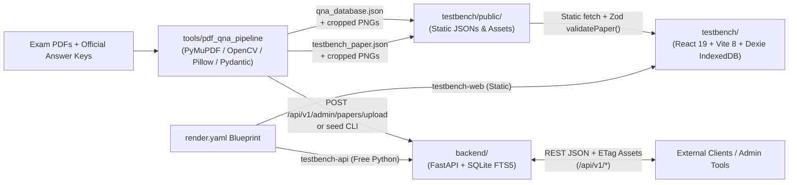
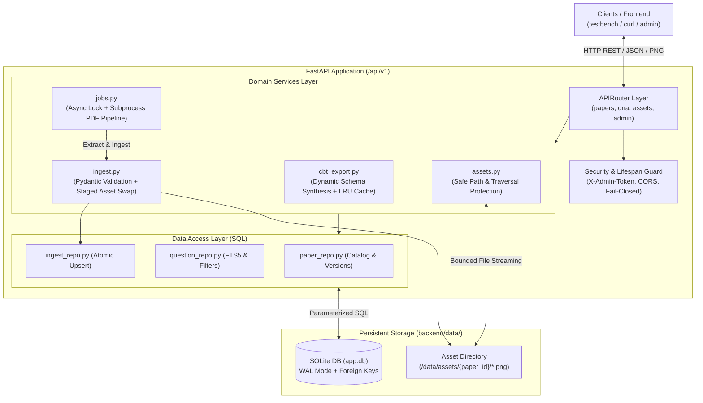
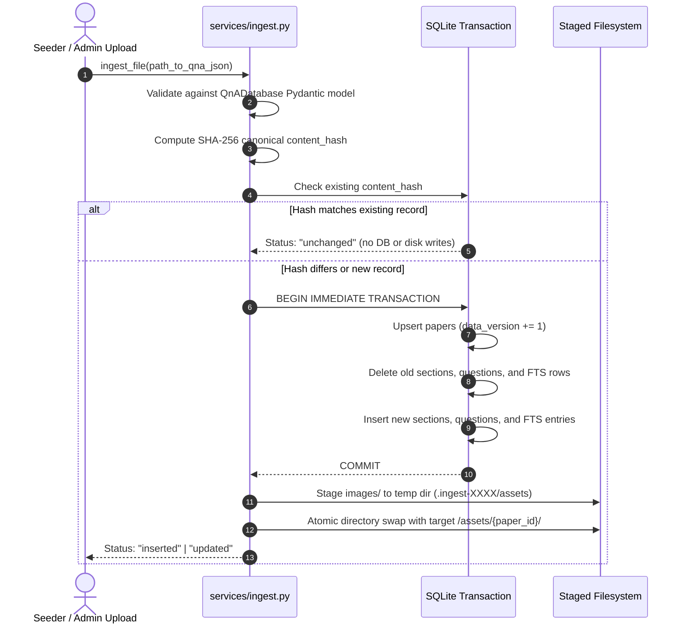
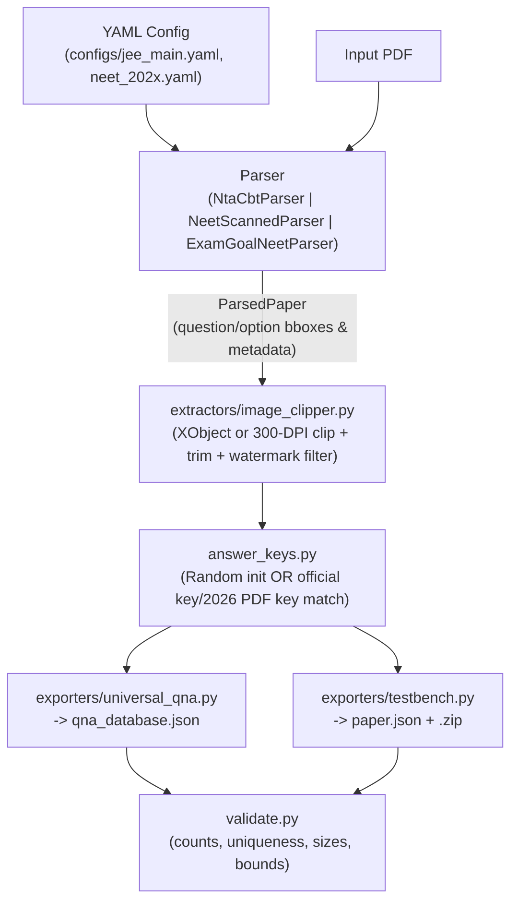

# TestBench Architecture (`v0.0.2(beta)`)

> Complete technical architecture of the **TestBench** monorepo: React/TypeScript NTA CBT web application (`testbench/`), interdependent FastAPI + SQLite REST backend (`backend/`), config-driven PDF-to-QnA extraction framework (`tools/pdf_qna_pipeline/`), and Render Blueprint deployment (`render.yaml`).

---

## 1. System Overview

TestBench is structured as three loosely coupled subsystems that share canonical JSON schemas (**Universal Q&A Schema `1.0`** and **TestBench CBT Paper Schema `1`**):



### Key Architectural Principles
1. **Local-First Web App:** `testbench/` executes mock exams, timing, evaluation, review, analytics, and theme preferences 100% client-side using **Dexie (IndexedDB)** and built-in static bundles under `testbench/public/`.
2. **Interdependent Standalone Backend:** `backend/` provides a versioned FastAPI service (`/api/v1/*`) backed by SQLite + FTS5 so papers, universal Q&A sets, and image assets can be ingested, queried, patched, and exported over HTTP independently of the frontend.
3. **Config-Driven Extraction Pipeline:** `tools/pdf_qna_pipeline/` separates layout parsing (`parsers/`), pixel clipping & watermark cleanup (`extractors/`), schema validation (`models.py`, `validate.py`), answer-key patching (`answer_keys.py`), and target exports (`exporters/`).

---

## 2. Repository Layout

```text
Work/
├── render.yaml                     # Render Blueprint (testbench-web + testbench-api)
├── README.md                       # Project documentation (v0.0.2(beta))
├── .gitignore                      # Excludes node_modules, .env, backend/data/, testbench/NEET/
├── architecture.md                 # This system architecture document
│
├── testbench/                      # Frontend SPA (React 19 + TypeScript + Tailwind v4)
│   ├── package.json                # v0.0.2-beta scripts & npm deps
│   ├── vite.config.ts              # Vite 8 + Vitest config
│   ├── public/
│   │   ├── icon.png
│   │   ├── papers/
│   │   │   ├── catalog.json        # Built-in JEE Main & NEET UG paper catalog metadata
│   │   │   ├── jee-main/*.json     # JEE Main 2023, 2024, 2026 PaperSchema JSONs
│   │   │   ├── neet/*.json         # NEET UG 2023, 2024, 2025, 2026 PaperSchema JSONs
│   │   │   └── assets/<paperId>/   # Cropped question & option PNGs
│   │   └── qna/*.json              # Universal Q&A JSONs (JEE 2026, NEET 2023..2026)
│   └── src/
│       ├── app/App.tsx             # HashRouter & route definitions + theme init
│       ├── core/                   # Pure TypeScript domain logic (framework-agnostic)
│       ├── data/                   # Dexie IndexedDB schema, catalog loader & repositories
│       ├── stores/                 # Zustand stores (examStore, paperStore, themeStore)
│       ├── hooks/                  # React hooks (useTimer, useAssetUrl)
│       ├── components/             # Shared UI primitives (Button, Dialog, Sheet, Img, RichText, ThemeToggle)
│       ├── features/               # Screen modules (library, instructions, exam, result, review, analytics, qna, settings)
│       └── i18n/                   # Localization dictionaries (en.json, hi.json)
│
├── backend/                        # Standalone FastAPI REST Backend
│   ├── requirements.txt            # FastAPI, uvicorn, pydantic-settings, pipeline libs, pytest
│   ├── .env.example                # Environment template
│   ├── backend-arch.md             # Backend architecture specification & staged roadmap
│   ├── KNOWN_ISSUES.md             # Operational follow-ups & known limitations
│   ├── README.md                   # Setup, execution, seeding & backup guide
│   ├── scripts/seed.py             # CLI seeder into SQLite + assets directory
│   ├── app/
│   │   ├── main.py                 # App factory, lifespan migration & startup token guard, error handlers
│   │   ├── settings.py             # Pydantic BaseSettings (NoDecode CORS_ORIGINS, DB_PATH, ADMIN_TOKEN)
│   │   ├── security.py             # Constant-time X-Admin-Token verification
│   │   ├── db.py                   # SQLite PRAGMA setup (WAL, FK, NORMAL, busy_timeout) & migrations
│   │   ├── migrations/001_init.sql # Schema: papers, sections, questions, jobs, questions_fts, schema_migrations
│   │   ├── models/api_models.py    # API Pydantic request/response models
│   │   ├── repositories/           # paper_repo.py, question_repo.py, ingest_repo.py
│   │   ├── routes/                 # papers.py, qna.py, assets.py, admin.py
│   │   └── services/               # ingest.py, jobs.py, assets.py, cbt_export.py
│   └── tests/                      # API, health, auth & ingest pytest suite
│
└── tools/pdf_qna_pipeline/         # Python PDF-to-QnA Extraction Framework
    ├── cli.py                      # inspect | extract | validate | export | enrich subcommands
    ├── config.py                   # YAML config loader
    ├── configs/                    # jee_main.yaml, neet_2023..2026.yaml
    ├── models.py                   # Universal Q&A Pydantic v2 models
    ├── answer_keys.py              # Random key initializer + NTA/PDF answer-key matchers
    ├── validate.py                 # Integrity checks (counts, IDs, options, asset bounds)
    ├── parsers/                    # base.py, nta_cbt.py, neet_scanned.py, examgoal_neet.py
    ├── extractors/image_clipper.py # XObject extraction, 300-DPI clip fallback, watermark/border cleanup
    ├── exporters/                  # universal_qna.py, testbench.py
    ├── enrich/                     # base.py, null_enricher.py (plug-in OCR/LaTeX hook)
    └── tests/                      # Regex, validation, clipper, parser, enrich & NEET pipeline tests
```

---

## 3. Frontend Architecture (`testbench/`)

### 3.1 Routing (`src/app/App.tsx`)
Uses `HashRouter` for zero-config static hosting and deep-link reload resilience:

| Route | Component | Responsibility |
| :--- | :--- | :--- |
| `/` | `LibraryScreen` | Exam catalog browsing (`All`, `JEE Main`, `NEET UG`), search, `Load All Papers`, `v0.0.2(beta)` branding, resume card |
| `/qna` | `QnADatabaseScreen` | Searchable & filterable Q&A bank explorer backed by `public/qna/*.json` + IndexedDB cache |
| `/paper/:id` | `PaperDetailScreen` | Paper metadata summary, section breakdown, marking badges, past attempt history |
| `/exam/:attemptId/instructions` | `InstructionsScreen` | Pre-test NTA general rules, language selector, agreement gate, start exam |
| `/exam/:attemptId` | `ExamScreen` | Full NTA CBT player (header timer, section tabs, question view, action bar, palette) |
| `/result/:attemptId` | `ResultScreen` | Live recomputed scorecard (`scorePaper`), accuracy, diagnostics, section table, retry generator |
| `/review/:attemptId` | `ReviewScreen` | Solution walkthrough (`All` / `Correct` / `Wrong` / `Skipped`), answer comparison, time spent |
| `/analytics` | `AnalyticsScreen` | Aggregate score, accuracy, and topic mastery across completed attempts |
| `/settings` | `SettingsScreen` | Theme (`light`/`dark`), text size, virtual numeric keypad toggle, IndexedDB stats/reset, `v0.0.2(beta)` About card |

### 3.2 Pure Domain Core (`src/core/`)
Designed to remain 100% React- and Dexie-free so it can run deterministically under Vitest:

- **Versioning (`core/version.ts`)**: Exports `APP_VERSION = 'v0.0.2(beta)'`, synced with `testbench/package.json` (`"version": "0.0.2-beta"`).
- **Schemas (`core/schema/`)**:
  - `paper.ts`: `PaperSchema` (`schemaVersion: 1`, kebab-case `id`, `navigation: 'free' | 'sectionLocked'`, `sections[]` with `attemptLimit?` and `marking`).
  - `question.ts`: Discriminated union across `single` (`SingleQuestionSchema` with `answer: z.array(z.string()).min(1)` supporting both standard single-key and NTA dual-key/bonus questions), `multi` (`MultiQuestionSchema`), `numerical` (`NumericalQuestionSchema` with exact/range/tolerance), and `tf` (`TFQuestionSchema`).
  - `attempt.ts`: `AttemptSchema`, `ResponseSchema`, and `QuestionStatus` (`notVisited | notAnswered | answered | marked | answeredMarked`).
- **Validation (`core/import/validate.ts`)**: `validatePaper()` runs two passes — Zod schema validation followed by cross-field domain checks (unique question IDs across sections, `attemptLimit <= questions.length`, valid option IDs in `answer`, valid `answerRange`). Used by catalog auto-loading (`data/catalog.ts`, `data/repositories/papers.ts`).
- **CBT State Machine (`core/exam/`)**:
  - `palette.ts`: Implements the NTA 5-state transition table (`visit`, `saveNext`, `markNext`, `clear`). Notice clearing an `answeredMarked` item keeps it `marked`; clearing an `answered` item returns it to `notAnswered`.
  - `machine.ts`: Pure `examReducer(state, action)` managing `START`, `SELECT_OPTION`, `TOGGLE_OPTION`, `SET_NUMERIC`, `SET_TF`, `SAVE_AND_NEXT`, `MARK_NEXT`, `CLEAR`, `JUMP_TO`, `SWITCH_SECTION`, `LOCK_SECTION`, `TAB_HIDDEN`/`TAB_VISIBLE`, `TICK`, and `SUBMIT` with per-question `timeSpentMs` flushing on every transition.
  - `timer.ts`: Absolute wall-clock `endsAt` calculation and formatting (`formatTime`), eliminating `setInterval` drift.
- **Marking & Scoring (`core/marking/`)**:
  - `evaluate.ts`: Evaluates single (supports multi-key via `question.answer.includes(studentAnswer[0])`), multi (full/partial/anyWrong), numerical (tolerance `1e-9` or `answerRange`), and T/F responses.
  - `score.ts`: `scorePaper(paper, responses)` enforces `section.attemptLimit` in order of section questions (excess attempted questions are treated as `skipped`), computes `sectionMax` using the top `min(attemptLimit, questions.length)` question `maxMarks` (giving exact `720` on 200-Q NEET papers and `300` on 90-Q JEE papers), and builds per-section, per-topic, and per-question breakdowns.

### 3.3 State Stores & IndexedDB (`src/stores/` & `src/data/`)
- **Dexie Database (`data/db.ts`, DB `"testbench"` v2)**:
  - `papers`: Cached validated `Paper` objects (`id, title, exam, updatedAt`)
  - `assets`: Optional local binary blobs (`key, paperId`)
  - `attempts`: Full test attempts, responses map, locked sections, and cached score results (`id, paperId, status, startedAt`)
  - `settings`: Key-value UI preferences (`textSize`, `showKeypad`, `theme`)
  - `qnaDatabases`: Cached Universal Q&A JSON datasets (`id, examName, year, updatedAt`)
- **Asset Resolution (`hooks/useAssetUrl.ts` & `components/Img.tsx`)**:
  - Attempts IndexedDB `assets` lookup first, then falls back cleanly to static `/papers/assets/${paperId}/${filename}`.
  - `Img.tsx` renders static inline diagrams/options with loading skeleton and error fallback (no click-to-zoom modal interception during exam option taps).
- **Atomic Submission (`stores/examStore.ts`)**:
  - `submitExam()` runs `examReducer(state, { type: 'SUBMIT' })`, scores the flushed responses via `scorePaper()`, awaits `saveAttempt()` to Dexie with `result` attached, and *then* updates Zustand `state.phase = 'submitted'`, guaranteeing `ResultScreen` never reads an incomplete attempt record.
  - `ResultScreen`, `ReviewScreen`, and `AnalyticsScreen` recompute `scorePaper(paper, attempt.responses)` dynamically whenever `paper` is available so results stay consistent with marking fixes.

---

## 4. Backend Architecture (`backend/`)

The backend is an independent, versioned FastAPI service (`uvicorn backend.app.main:app --host 0.0.0.0 --port 8000`) backed by SQLite in Write-Ahead Logging (WAL) mode. It serves as the **single source of truth** for exam papers, universal question banks, and cropped question/option PNG assets.



---

### 4.1 Architectural Role & Design Principles
1. **Single Canonical Store (Universal Q&A Schema `1.0`):** The relational database stores papers, sections, and questions in the normalized Universal Q&A schema (`examMetadata`, `sections`, `questions` with raw JSON columns for content, options, answer, and source). The client-facing TestBench CBT schema is **derived dynamically** on-the-fly, preventing schema drift or duplicate sources of truth.
2. **Layered Separation of Concerns:**
   - **Routes (`app/routes/*`):** Parameter binding, HTTP status codes, header injection (`ETag`, `X-Data-Version`), and error envelope translation. Routes contain zero SQL.
   - **Services (`app/services/*`):** Pure domain logic including ingestion validation, asynchronous job scheduling, path sanitization, and CBT export caching.
   - **Repositories (`app/repositories/*`):** SQL-only query construction using parameterized queries and FTS5 search logic.
   - **Models (`app/models/api_models.py`):** Strictly typed Pydantic v2 schemas for all API payloads and query responses.
3. **Fail-Closed Security & Deterministic Isolation:** The service refuses to boot in production if `ADMIN_TOKEN` is unset or left at its default placeholder. Asset streaming strictly forbids path traversal outside the sandboxed asset directory.

---

### 4.2 SQLite Database Architecture & Concurrency

Managed in `app/db.py` with automatic numbered migrations in `app/migrations/001_init.sql`.

#### SQLite Connection PRAGMAs
Every SQLite connection initializes with concurrency and integrity pragmas:
```sql
PRAGMA foreign_keys = ON;
PRAGMA journal_mode = WAL;
PRAGMA synchronous = NORMAL;
PRAGMA busy_timeout = 5000;
```
- **WAL (`Write-Ahead Logging`):** Enables simultaneous non-blocking concurrent readers alongside active writes.
- **`busy_timeout = 5000`:** Enforces 5-second lock acquisition backoff, mitigating `SQLITE_BUSY` errors during concurrent ingestion or answer patching.

#### Relational Schema & Full-Text Search
- **`schema_migrations`:** Records applied migration numbers (`version PRIMARY KEY`, `applied_at`). The lifespan runner in `db.py` scans `migrations/*.sql` and applies unapplied migrations sequentially on startup.
- **`papers`:**
  - Columns: `id TEXT PRIMARY KEY` (regex checked `^[a-z0-9][a-z0-9-]{0,80}$`), `title`, `exam`, `year`, `total_questions`, `duration_min`, `exam_metadata_json`, `data_version INTEGER DEFAULT 1`, `content_hash TEXT`, `created_at`, `updated_at`.
- **`sections`:**
  - Composite primary key `(paper_id, section_id)`.
  - Columns: `section_name`, `subject`, `question_type`, `marking_json`, `position INTEGER`.
  - Cascades on paper deletion (`ON DELETE CASCADE`).
- **`questions`:**
  - Unique primary key `id TEXT` (formatted as `<paper_id>:<question_id>`).
  - Columns: `paper_id`, `question_number INTEGER`, `question_id TEXT` (NTA official ID), `section_id`, `subject`, `type` (`single_choice` or `numeric`), `content_json`, `options_json`, `answer_json`, `explanation_json`, `source_json`.
  - Unique constraints: `UNIQUE (paper_id, question_number)` and `UNIQUE (paper_id, question_id)`.
  - Indexes: `idx_q_paper_subject` and `idx_q_paper_section`.
- **`questions_fts` (SQLite FTS5):**
  - Virtual table: `fts5(question_id UNINDEXED, paper_id UNINDEXED, body, tokenize='unicode61')`.
  - Keeps question text search fast and allows full-text querying across question content bodies.
- **`jobs`:**
  - Columns: `id TEXT PRIMARY KEY` (UUIDv4), `status` (`queued | running | done | failed`), `paper_id`, `error`, `created_at`, `finished_at`.

---

### 4.3 Ingestion & Seeding Engine (`services/ingest.py` & `scripts/seed.py`)

Ingestion accepts any folder containing `qna_database.json` and an `images/` directory.



- **Idempotence:** If a paper’s canonical JSON content hash has not changed, the seeder outputs `unchanged` and performs zero database writes or file copies.
- **Two-Stage Asset Swapping (`_replace_assets`):** To prevent corrupted or missing images if a process is interrupted, images are copied into a temporary staging folder (`.ingest-XXXX/`) beside `backend/data/assets/{paper_id}/`. Once staging completes, the directories are swapped atomically via filesystem `replace()`.
- **Bulk Seeding CLI:**
  ```powershell
  python -m backend.scripts.seed --dir dist/qna
  ```
  Scans all subdirectories, reports per-paper statuses (`inserted`, `updated`, `unchanged`, or `failed`), and prints a summary.

---

### 4.4 Dynamic CBT Paper Synthesis (`services/cbt_export.py`)

Rather than maintaining duplicate CBT JSON files in the database, the backend converts canonical Universal Q&A relational rows into the client's `PaperSchema` format on demand:
- **Type Mapping:** Transforms `single_choice` to `single` and `numeric` to `numerical`.
- **Asset URL Resolution:** Translates internal image filenames (`q_691121151.png`, `opt_691121511.png`) into versioned, absolute API endpoints: `/api/v1/assets/{paper_id}/{filename}`.
- **Key Binding:** Identifies single-choice correct options by matching the official `optionId` with the question's option list to derive student-facing option labels (`"a"`, `"b"`, `"c"`, `"d"`).
- **LRU In-Memory Cache:** `_cached` uses `@lru_cache(maxsize=64)` keyed by `(paper_id, content_hash, metadata_json, rows_json)`. Repeated requests for the same paper return instantly from memory with zero database or JSON parsing overhead.

---

### 4.5 Background PDF Ingest & Extraction Job Lifecycle (`services/jobs.py` & `routes/admin.py`)

Admin users can upload raw exam PDFs directly to `/api/v1/admin/papers/upload` to trigger automated background extraction:

1. **Gatekeeping:** Checks `application/pdf` MIME type, verifies `%PDF-` magic header bytes, and enforces `MAX_UPLOAD_MB` (default 50 MB).
2. **Concurrency Serialization:** Uses an `asyncio.Lock` (`_pipeline_lock`) to serialize heavy pipeline extractions, ensuring only one background pipeline process executes at any given time to protect CPU and memory.
3. **Execution Guardrails:**
   - Pre-scans PDF page count using PyMuPDF (rejects documents > 60 pages).
   - Verifies the extraction config name against a strict regex and ensures the corresponding YAML exists under `tools/pdf_qna_pipeline/configs/`.
   - Runs `python -m tools.pdf_qna_pipeline.cli extract` in an isolated subprocess with a 600-second hard timeout.
4. **Auto-Ingestion & Cleanup:** Upon subprocess completion, immediately executes `ingest_file()` on the resulting `qna_database.json`, commits the rows and assets, marks the job `done` with the generated `paperId`, and deletes temporary job scratch directories.

---

### 4.6 REST API Contract (`/api/v1/*`)

All JSON responses use UTF-8. Public endpoints require no authentication. Admin endpoints require `X-Admin-Token`.

| Endpoint | Method | Auth | Response | Purpose & Caching Semantics |
| :--- | :--- | :--- | :--- | :--- |
| `/health` | `GET` | Public | `200` / `503` | Executes `SELECT 1` on SQLite. Returns `{"status":"ok","apiVersion":"v1","dbOk":true}`. |
| `/papers` | `GET` | Public | `CatalogResponse` | Lists paper summaries: `id`, `title`, `exam`, `year`, `durationMin`, `totalQuestions`, `sectionsCount`, `badge`. |
| `/papers/{id}` | `GET` | Public | `PaperSchema` | Dynamic CBT JSON. Returns `ETag: "<content_hash>"` and `X-Data-Version`. Supports `If-None-Match` -> `304 Not Modified`. |
| `/papers/{id}/download` | `GET` | Public | JSON Attachment | Downloads formatted CBT JSON with `Content-Disposition: attachment; filename="{id}.json"`. |
| `/qna/{id}` | `GET` | Public | `UniversalQna` | Complete Universal Q&A JSON export with `ETag` and `X-Data-Version`. Supports `304 Not Modified`. |
| `/qna/{id}/questions` | `GET` | Public | `PaginatedQuestions` | Filtered question search. Supports `subject`, `type` (`single_choice`/`numeric`), `section`, `search`, `page`, `limit`. |
| `/qna/{id}/questions/{num}` | `GET` | Public | `Question` | Directly fetches a single question record by its 1-based question number within the exam. |
| `/assets/{id}/{filename}` | `GET` | Public | `image/png` | Streams validated PNG asset with `SHA-256` ETag and `Cache-Control: public, max-age=31536000, immutable`. |
| `/admin/papers/upload` | `POST` | Admin | `202 Accepted` | Uploads PDF multipart file with optional `config` form field. Spawns background pipeline job, returns `{"jobId":"..."}`. |
| `/admin/jobs/{job_id}` | `GET` | Admin | `JobResponse` | Polls extraction job status (`queued`, `running`, `done`, `failed`), associated `paperId`, and error details. |
| `/admin/papers/{id}/answers`| `PATCH` | Admin | `AnswerPatchResponse` | Atomically patches official answer keys across question IDs, validates option bounds, and increments `data_version`. |
| `/admin/papers/{id}` | `DELETE`| Admin | `204 No Content` | Cascades deletion across SQLite database rows and purges the asset folder from disk. |

#### Standardized Error Envelope
All client and server errors adhere to a uniform structure:
```json
{
  "error": {
    "code": "not_found",
    "message": "Paper 'jee-main-2024' not found",
    "details": null
  }
}
```
Standard codes: `not_found` (404), `validation_error` (422), `unauthorized` (401), `payload_too_large` (413), `unsupported_media_type` (415), `conflict` (409), `internal_error` (500).

---

### 4.7 Security Architecture & Defensive Controls

1. **Strict Path Traversal Neutralization (`services/assets.py`):**
   - Inputs are validated against strict regex: `PAPER_RE` (`^[a-z0-9][a-z0-9-]{0,80}$`) and `FILENAME_RE` (`^(q|opt)_[0-9]+(_[0-9]+)?\.png$`).
   - Resolves target paths and validates that `base in target.parents`. Any illegal access attempt (e.g., `../../app.db`, encoded dots `%2e%2e`, symlinks pointing outward) raises a generic `404 Not Found` without disclosing filesystem structure.
2. **Timing-Attack Resilient Admin Authentication (`security.py`):**
   - Guards admin endpoints by validating the `X-Admin-Token` header using `hmac.compare_digest`.
   - Lifespan startup check aborts boot if `ADMIN_TOKEN` is unset or set to example strings unless `ALLOW_INSECURE_DEV=1`.
3. **CORS Hardening (`settings.py`):**
   - Parses allowed origins via `NoDecode` to handle both JSON arrays and comma-separated env values.
   - Forbids wildcard `*` whenever `allow_credentials=True` is enabled.
4. **Injection-Safe Parameterized Queries:**
   - 100% of SQL statements use parameter bindings (`?`).
   - User search keywords inside FTS queries are sanitized via `_fts_query()` by quoting phrases to prevent SQLite FTS syntax injection.

---

### 4.8 Current Operational State & Subsystem Status

| Subsystem / Feature | Current State | Notes |
| :--- | :--- | :--- |
| **FastAPI REST Server** | **Operational** | Runs standalone on port 8000; tested with Uvicorn. Configured in `render.yaml` as `testbench-api`. |
| **SQLite WAL Storage** | **Operational** | Auto-migrated schema with `schema_migrations`, foreign keys enabled, and FTS5 search indexing. |
| **Catalog & CBT Export** | **Operational** | `/api/v1/papers` and `/api/v1/papers/{id}` dynamically synthesize compliant `PaperSchema` with ETag caching. |
| **Universal Q&A API** | **Operational** | Full database export and paginated question search by subject, question type, and text. |
| **Asset Streaming** | **Operational** | Path-traversal proof streaming with SHA-256 ETags and immutable cache headers. |
| **CLI Seeding Engine** | **Operational** | `python -m backend.scripts.seed --dir dist/qna` performs idempotent, transaction-safe upserts. |
| **Admin PDF Upload Pipeline**| **Operational** | Background job queue with PyMuPDF page check, single-concurrency lock, and subprocess CLI execution. |
| **Automated Tests** | **Operational** | Pytest suites in `tests/test_health.py` and `tests/test_ingest.py` verify health, migrations, and atomic ingestion. |
| **Frontend Integration** | **Local-First (Current)** | `testbench` currently loads bundled JSONs from `testbench/public/`. Stage 6 will wire `apiClient.ts` for dual-mode sync with Dexie. |

#### Known Operational Considerations (`KNOWN_ISSUES.md`)
- **Subprocess Isolation:** Background PDF extraction runs with a 600-second timeout and an `asyncio.Lock`, but runs without an OS sandbox container. Uploaded PDFs should be treated as untrusted, and the API should be kept on a private network or behind a proxy until containerized sandboxing is enabled.
- **Admin Rate Limiting:** Constant-time token verification is active; per-IP rate limiting on admin endpoints is planned for subsequent iterations.

---

## 5. PDF-to-QnA Extraction Pipeline (`tools/pdf_qna_pipeline/`)

Supports both digital NTA CBT PDFs (`jee_main`) and scanned/multi-column NEET UG PDFs (`neet_2023`–`neet_2026`).



### Pipeline Components
- **Parsers (`parsers/`)**:
  - `NtaCbtParser`: Extracts selectable NTA headers (`Question Number`, `Question Id`, `Question Type`, `Option Id`) and links embedded raster images across page breaks.
  - `NeetScannedParser`: Two-column scanned paper segmenter for official NTA booklets (2023 Code G6, 2024 Code S6, 2025 Code 45).
  - `ExamGoalNeetParser`: Handles NEET 2026 multi-column PDF while filtering/stripping third-party branding/watermarks.
- **Image Clipping (`extractors/image_clipper.py`)**: Extracts native XObjects or renders coordinate clips at high DPI, merges vertical slices across page splits, removes third-party watermark overlays where configured, strips alpha channels onto crisp white backgrounds, and trims whitespace with padding.
- **Two-Phase NEET Workflow (`cli.py` + `answer_keys.py`)**: Allows extracting all papers first with valid randomized placeholder keys (`generate_random_answers`), then bulk-patching official NTA keys (`parse_2023_answer_key`, `parse_2024_or_2025_answer_key`, `parse_2026_pdf_answer_key`) into both `qna_database.json` and `paper.json`, preserving dual/bonus official keys (`["a", "b"]`, `["a", "b", "c", "d"]`).

---

## 6. Deployment & Infrastructure (`render.yaml`)

Deploys two coordinated services via Render Blueprint:
1. **`testbench-web`** (`runtime: static`, `rootDir: testbench`): Runs `npm ci && npm run build`, publishes `dist/`, and applies SPA rewrite `/* -> /index.html`.
2. **`testbench-api`** (`runtime: python`, `plan: free`): Installs `backend/requirements.txt` on Python `3.12.7`, runs `uvicorn backend.app.main:app --host 0.0.0.0 --port $PORT`, health-checked at `/api/v1/health`, with auto-generated `ADMIN_TOKEN`, `ALLOW_INSECURE_DEV=0`, and explicit `CORS_ORIGINS`.
