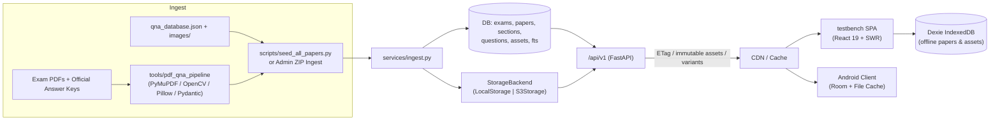

# TestBench Architecture (`v0.0.3`)

> Complete technical architecture of the **TestBench** monorepo: React/TypeScript NTA CBT web application (`testbench/`), backend service (`backend/`) serving as single source of truth for all papers, questions, answer keys, and assets, config-driven PDF-to-QnA extraction framework (`tools/pdf_qna_pipeline/`), and Render Blueprint deployment (`render.yaml`).

---

## 1. System Overview

In `v0.0.3`, all paper JSON data, answer keys, and question/option screenshots are decoupled from the frontend static bundle and hosted authoritatively by `backend/`. The backend serves two clients: the React web app and the planned Android client.



### Key Architectural Principles
1. **Backend as Single Source of Truth:** `testbench/public/` contains zero exam papers or screenshot assets. All content is fetched dynamically from `/api/v1` and cached locally.
2. **Local-First & Offline Resilience:** Mock exams run 100% client-side after a paper or package is downloaded. Offline practice is powered by Dexie IndexedDB with resumable multi-threaded asset caching.
3. **Multi-Client Public Contract:** The API is versioned and additive-only. Clients declare capabilities via `X-Client`, `X-Features`, and `X-Schema-Max`. Contract stability is checked via `backend/openapi.v1.json` in CI.
4. **Scoring Parity:** Scoring rules are governed by golden test vectors (`contracts/scoring/*.json`) verified against Vitest and backend test suites, guaranteeing identical marks on web and Android.
5. **Content-Addressed Storage:** Assets are stored by SHA-256 hash. Pre-generated WebP variants (480px, 720px, 1080px) and offline `.zip` bundles are automatically synthesized during ingestion.

---

## 2. Repository Layout

```text
Work/
├── render.yaml                     # Render Blueprint (testbench-web + testbench-api persistent starter)
├── README.md                       # Project documentation (v0.0.3)
├── .gitignore                      # Excludes node_modules, .env, backend/data/, public/papers/, public/qna/
├── architecture.md                 # System architecture document (v0.0.3)
│
├── contracts/scoring/              # Golden scoring test vectors for multi-client parity
│   ├── single-mcq.json
│   ├── attempt-limits.json
│   ├── numeric-tolerance.json
│   └── dual-key-bonus.json
│
├── backend/                        # Standalone FastAPI REST Backend
│   ├── requirements.txt            # FastAPI, uvicorn, pillow, boto3, pydantic-settings, pytest
│   ├── openapi.v1.json             # Published OpenAPI contract snapshot (21 endpoints)
│   ├── seeds/                      # Seed paper & Q&A JSONs for clean deployments
│   ├── app/
│   │   ├── main.py                 # App factory, lifespan migrations, token guard, CORS
│   │   ├── settings.py             # Pydantic BaseSettings (Storage backend, S3, DB_PATH, ADMIN_TOKEN)
│   │   ├── security.py             # Constant-time X-Admin-Token verification
│   │   ├── db.py                   # SQLite PRAGMA setup (WAL, FK, NORMAL) & migrations
│   │   ├── migrations/
│   │   │   ├── 001_init.sql        # Initial schema
│   │   │   └── 002_extensibility.sql # Exams registry, assets, asset_variants, paper_packages
│   │   ├── storage/                # StorageBackend protocol, LocalStorage, S3Storage
│   │   ├── question_types/         # Modular question type registry (single, multi, numerical, tf)
│   │   ├── models/api_models.py    # API request/response models
│   │   ├── repositories/           # paper_repo.py, question_repo.py, ingest_repo.py
│   │   ├── routes/                 # meta.py, exams.py, papers.py, qna.py, assets.py, admin.py
│   │   └── services/               # ingest.py, assets.py, cbt_export.py, jobs.py
│   └── tests/                      # Pytest suite (API v1, migrations, storage, openapi contract)
│
├── testbench/                      # Frontend SPA (React 19 + TypeScript + Tailwind v4)
│   ├── package.json                # v0.0.3 scripts & dependencies
│   ├── vite.config.ts              # Vite 8 + Vitest configuration
│   ├── public/                     # Static app shell icons and sample mocks ONLY
│   │   ├── icon.png, favicon.svg, icons.svg, manifest.webmanifest
│   │   └── samples/sample-mock-01.json
│   └── src/
│       ├── app/App.tsx             # HashRouter & route definitions
│       ├── core/
│       │   ├── schema/             # Paper & Attempt (v3) schemas
│       │   ├── question-types/     # Modular client question-type registry
│       │   ├── marking/strategies/ # NTA Standard & WBTET Standard marking evaluators
│       │   └── version.ts          # Release version constant (v0.0.3)
│       ├── data/
│       │   ├── apiClient.ts        # Typed HTTP client (SWR, timeouts, retry, headers)
│       │   ├── db.ts               # Dexie IndexedDB v3 (papers, assets, qnaDatabases, attempts)
│       │   ├── catalog.ts          # Paper summaries & metadata
│       │   └── repositories/       # papers.ts, assets.ts, qna.ts, attempts.ts
│       ├── hooks/useAssetUrl.ts    # Priority asset resolver (Dexie -> API -> static fallback)
│       └── features/               # Screen modules (library, instructions, exam, result, review)
│
└── tools/pdf_qna_pipeline/         # Python PDF-to-QnA Extraction Framework
    ├── cli.py                      # inspect | extract | validate | export | enrich subcommands
    ├── configs/                    # Exam parser YAML definitions
    ├── parsers/                    # NtaCbtParser, NeetScannedParser, ExamGoalNeetParser
    └── extractors/                 # image_clipper.py (watermark stripping & high-DPI cropping)
```

---

## 3. Storage & Extensibility Architecture

### 3.1 StorageBackend Protocol (`backend/app/storage/`)
Pluggable storage allows seamless switching between local disks and object storage:
- **`LocalStorage`**: Stores content in `backend/data/assets/`, path-traversal proof with containment checks.
- **`S3Storage`**: Streams directly to AWS S3 or Cloudflare R2 using `boto3`.

### 3.2 Content-Addressed Assets & Variants
Images are hashed with SHA-256 upon ingest:
1. Canonical original stored at `assets/<sha256>.<ext>`.
2. Variants auto-generated via Pillow:
   - Widths: 480px, 720px, 1080px.
   - Formats: WebP (lossy Q=85, max dimensions preserved).
3. Resolved via `GET /api/v1/assets/{paperId}/{filename}?w=720` or `Accept: image/webp`.
4. Header: `Cache-Control: public, max-age=31536000, immutable`.

### 3.3 Offline Paper Packages (`paper_packages`)
Each paper can be pre-packaged into a single `.zip` file containing `paper.json`, `manifest.json`, and all assets.
- Served at `GET /api/v1/papers/{id}/package`.
- Supports HTTP `Range` headers for resumable downloads on mobile networks.

---

## 4. Multi-Client API Contract (`/api/v1/*`)

| Endpoint | Method | Auth | Description |
| :--- | :--- | :--- | :--- |
| `/meta` | `GET` | Public | Version info, min supported client versions, active features, server time. |
| `/exams` | `GET` | Public | Registry of supported exam types, badges, durations, marking strategies. |
| `/exams/{code}` | `GET` | Public | Detailed layout & default sections for an exam type. |
| `/papers` | `GET` | Public | Lists papers matching client capabilities (`X-Features`, `X-Schema-Max`). |
| `/papers/{id}` | `GET` | Public | Synthesizes CBT Paper JSON with ETag caching and 304 handling. |
| `/papers/{id}/manifest` | `GET` | Public | List of all asset filenames, content hashes, sizes, and URLs. |
| `/papers/{id}/bundle` | `GET` | Public | Paper JSON + Manifest in a single roundtrip. |
| `/papers/{id}/package` | `GET` | Public | Offline `.zip` bundle with HTTP 206 `Range` support. |
| `/assets/{id}/{filename}` | `GET` | Public | Content-addressed asset delivery with variant negotiation (`?w=`). |
| `/qna/{id}` | `GET` | Public | Full Universal Q&A export. |
| `/qna/{id}/questions` | `GET` | Public | Paginated and filtered question bank search. |
| `/admin/papers/ingest` | `POST` | Admin | Ingests a `.zip` package containing `qna_database.json` and `images/`. |
| `/admin/papers/{id}/assets/{file}` | `PUT` | Admin | Replaces a single question screenshot, re-hashing and re-packaging. |

---

## 5. Frontend Integration (`testbench/`)

### 5.1 SWR Caching & Dexie v3
- **`apiClient.ts`**: Handles authentication headers, client identification (`X-Client: web/0.0.3`), timeouts, and automatic retry on 503/network failures.
- **`repositories/papers.ts`**: Stale-while-revalidate pattern:
  1. Instantly returns paper from Dexie if cached.
  2. Background-revalidates with `If-None-Match: <etag>`.
  3. Updates Dexie cache on `200 OK`.
- **`isPaperAvailableOffline(id)` & `downloadPaperForOffline(id)`**:
  - Concurrency-limited (5 parallel streams) resumable asset downloader.
  - PaperDetailScreen provides real-time download progress and "Offline Ready" badges.

### 5.2 Dynamic Registries
- **Exam Tabs**: Dynamically populated from `GET /api/v1/exams` with fallback to default exam tabs.
- **Question Types**: Modular registry supporting `single`, `multi`, `numerical`, and `tf`.
- **Marking Strategies**: Pluggable evaluation strategies (`nta-standard`, `wbtet-standard`) mapping section strategies to scoring logic.

---

## 6. Operational Status

| Subsystem / Feature | Current State | Notes |
| :--- | :--- | :--- |
| **FastAPI REST Server** | **Operational** | Versioned API (`/api/v1`) with OpenAPI contract verification. |
| **Storage & Variants** | **Operational** | LocalStorage + S3Storage with automatic WebP variant generation. |
| **Content Ingestion** | **Operational** | Full ingestion pipeline for both Universal Q&A and CBT formats. |
| **Offline Packages** | **Operational** | Zip generation with HTTP 206 partial content support. |
| **Golden Scoring Parity** | **Operational** | 4 golden test vectors verified against TypeScript and Python scorers. |
| **Frontend Integration** | **Operational** | Single source of truth backend; Dexie SWR offline cache; zero public papers bundled. |
| **Deployment Config** | **Operational** | `render.yaml` configured with persistent disk, starter plan, and post-deploy seed script. |
